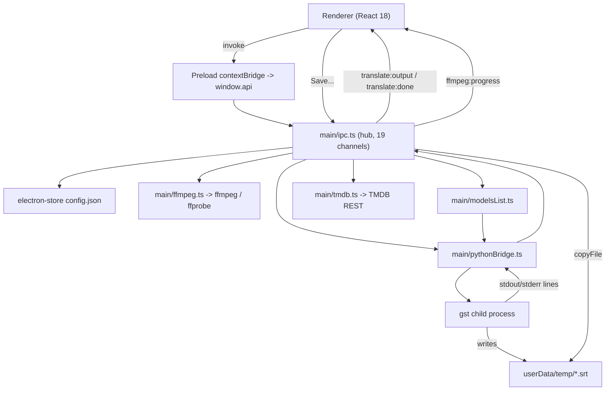

# Architecture

A map of how this app is put together, for anyone who wants to change it. It covers the entry
points, how data moves, which helpers are shared, what the translation engine guarantees, and the
handful of hazards that have bitten before.

## What it is

An Electron + React/TypeScript desktop UI wrapping the [`gemini-srt-translator`][gst] Python CLI
(binary name `gst`, engine 3.7.0 bundled).

**The UI never calls the Gemini API itself.** It builds a `gst` command line, spawns it as a child
process, streams stdout and stderr back to the renderer, and copies the resulting file wherever the
user asks. Keeping the boundary there means engine upgrades are mostly a matter of arguments and
output parsing, which is why both of those have their own contract tables below.

[gst]: https://github.com/MaKTaiL/gemini-srt-translator

## Layout

```
electron/
  main/      index.ts ipc.ts store.ts migrations.ts pythonBridge.ts ffmpeg.ts modelsList.ts tmdb.ts
  preload/   contextBridge -> window.api, plus its .d.ts contract
  shared/    types.ts languages.ts modelCaps.ts keyOrder.ts   (imported by BOTH processes)
             outputSanity.ts ffmpegProgress.ts maskedCommand.ts stallBudget.ts   (pure, gate-tested)
src/
  App.tsx    pages/  components/  lib/useRunner.ts  store/useStore.ts  data/
scripts/
  build_python.py   freezes the engine with PyInstaller
  gates/            the automated check suite
  verify/           optional live checks against a real API key
  check-bin.mjs     release preflight
resources/bin/      gst, ffmpeg, ffprobe  (git-ignored; see "Getting the binaries")
```

## Entry points

**Main process.** `electron/main/index.ts`, in order:

1. `app.whenReady()`
2. `logResolvedGstBin()` — prints which `gst` this session will run, resolving a bare name against
   the same PATH a child process would see. Permanent by design; see hazard 2. It formats
   `describeEngine()`, which is also what `engine:info` returns, so the console and the UI cannot
   report different binaries.
3. `registerIpc()` — registers all 20 channels. **Side effect:** importing `./ipc` transitively
   imports `./store`, which runs the settings migration chain at module load.
4. `createWindow()` — one `BrowserWindow`, external links routed to the system browser.

**Renderer.** `index.html` → `src/main.tsx` → `src/App.tsx`. There is no router: `App.tsx` holds a
tab in `useState`, and all three pages stay **mounted** with visibility toggled by a class, so page
state survives tab switches. The app always opens on Translate.

## Runtime topology



`contextIsolation: true`, `nodeIntegration: false`. The renderer only ever sees `window.api`.

## Data lifecycle

### Settings

Stored by `electron-store` in `config.json` under the user-data directory. `getSettings()` returns
the whole object; `setSettings(patch)` merges key by key and returns the full object, which replaces
the renderer's mirror.

**Migrations run at `store.ts` module load, on every start**, but are version-gated by
`schemaVersion`, so a migrated profile skips the chain entirely. The chain is idempotent, *filters
rather than resets*, bumps the version last, and writes a `config.pre-migration-v<n>.json` backup
before its first migrated write. It lives in `migrations.ts` and imports no Electron API, so the
test suite can execute the real chain rather than a copy of it.

Two rules the chain must keep:

- **A migration may flag, but never replace, a user's model.** It runs offline at store load and
  cannot know what the API offers today.
- **Constants it reads must be right before it runs.** A later correction to `DEFAULT_MODEL_ID`
  cannot reach a profile that has already been migrated past that step.

### Model list

```
"Fetch Models & Check API Keys"
  -> checkApiKeys(keys)
     -> refreshModels(key) for EVERY non-empty key   [gst list-models -k KEY --skip-upgrade]
        -> regex-extract gemini-* ids  (RAW ids, no curation)
     -> summarizeRefresh(slots, activeSlots)
        -> unionIds (for display) + runnableIds (intersection over the ACTIVE set)
        -> outcome: allComplete | activeComplete | partial | failed
     -> buildModelList(unionIds, availability)       curation + provenance
  -> applyModelSelectionRules(stored, prevCached, next)
     -> three cases only: fresh install | proven absence | auto-advance
```

Two properties here are load-bearing and easy to break by accident:

- **`refreshModels` returns raw ids, never a curated list.** Availability has to be decided from
  what the API said, not from what the picker chose to display.
- **A partial or failed refresh does not touch the cache.** Overwriting on a partial result drops
  models that only a currently-unreachable key can see.
- **A refresh may only be applied to the keys it asked about.** Verdicts, errors and
  `ModelInfo.availableOn` are all addressed by *slot index* and carry no trace of the key that
  produced them, while a full check is a sequence of network round trips lasting up to a minute per
  key. So the key fields are locked while one runs, and a result whose key snapshot has moved is
  discarded whole — never applied in part, which would leave the verdicts, the cache and the stored
  selection describing three different moments.

The evidence bar is deliberately asymmetric: an `allComplete` refresh is required to *delete* a
user's selection, while `activeComplete` is enough to advance a default nobody chose. That is what
keeps a bad network from quietly resetting someone's model.

### Translate job

1. `TranslatePage` gathers input (an SRT/ASS file, or a video plus a chosen track), languages and an
   optional TMDB description.
2. From a video track, ffmpeg extracts to a temp subtitle file first.
   Any track can also be extracted to a file of the user's choosing, including an image-based (PGS)
   one, which is exported as `.sup` because it is a bitmap and cannot be translated at all. The two
   acts are separate controls: the radio chooses what to *translate*, the button on each row saves
   that track out. Both run under one lock and report a live percentage — on a 50 GB container either
   can run for minutes, and the page refuses to start a second ffmpeg while one is working.
3. `translate:start` runs the pre-spawn model guard, merges log flags from settings, and calls
   `startTranslate`.
4. `startTranslate` normalises the input encoding, builds the argv, and spawns `gst`.
5. Output is line-buffered and pushed to the renderer as it arrives; on close a single
   `translate:done` carries the exit code, the output path, any log sidecars, any sanity warnings
   about the finished file, and — when the app rather than the engine ended the run — the reason it
   did. A killed process and a crashed one both exit non-zero, so only the main process can tell them
   apart, and it says so instead of leaving the renderer to guess: a run the user stopped reads as
   *Stopped*, never as a failure.
6. `useRunner` parses the stream for progress and token counts; the page then copies the temp output
   and its sidecars to the user's chosen path, named from the extension the engine actually produced.

The engine redraws its whole message history on every streamed chunk, so a run can emit thousands of
lines that say one thing — one measured run produced 9,900 lines carrying eleven distinct messages.
The panel therefore folds a redrawn block into a single row with a repeat counter and keeps a fixed
head plus a rolling tail, marking how many lines the middle lost. Folding only ever removes text that
is still on screen elsewhere. It also follows the newest line only while the view is already at the
bottom, so scrolling up during a run holds position.

Because the panel is capped and folded, it is the wrong thing to export — an export of it would be
missing the middle of the run with its repetition already flattened away. So every run also writes a
`.console.log` beside its output as it happens, containing what the run actually said: the command
line, the app's own notices and both engine streams, uncapped and unfolded. It is opened when the job
takes its slot and closed on every ending, including a Stop, so a run that failed still has a
complete record. Its own ceiling keeps both ends — a streamed head and a retained tail either side of
a marker naming the missing lines — because a run long enough to be truncated is one that went wrong,
and what went wrong is at the end. A single line is bounded too, and separately: the engine's output
is split on newlines, so a chunk containing none of them arrives as one line, and a limit that only
counted lines would not have held. The cut lands on a character boundary rather than an arbitrary
byte. A translation's copy travels with the subtitle when you save it; a transcription's is already
beside the output it wrote, and a run that never reached a save — because it failed or was stopped —
names the original where it lies, since that is the run whose log is worth reading.

On a successful run the main process reads the finished subtitle back and compares it against its
source (`electron/shared/outputSanity.ts`). The engine validates a batch by *counting* items rather
than reading them, so a model that returns filler for part of a batch still reports success — a
measured run emitted a two-character string for 136 consecutive cues and was written out as
complete. Three relative signals must agree in pairs before anything is said: a run of identical
translations, a collapse in length relative to the run's own median, and disagreement in line
structure. The result is **advisory only**. Nothing is repaired, no save is blocked, and the file on
disk stays byte-identical to what the engine wrote.

Note that step 3 can fail **synchronously** — a busy job slot, a refused non-UTF-8 `.ass`, a spawn
that throws — so anything the completion callback closes over must already be initialised when
`startTranslate` is called.

### Saying that long work is progressing

Several things here legitimately take minutes, and an app that says nothing for minutes is
indistinguishable from one that has hung. The design turns on a single question — **can this wait be
measured?**

- **The app's own ffmpeg calls can.** Track extraction and audio conversion run with
  `-progress pipe:1`, and one `ffprobe` for the duration turns the reported position into a
  percentage. `electron/shared/ffmpegProgress.ts` owns the parsing, and it is pure so that a *wrong*
  number — the real failure mode of a progress bar — is catchable by a test.
- **The engine's internal ffmpeg cannot.** It captures its output and returns it on exit, so its
  extraction and MP3 steps have no progress to recover without forking a pinned dependency. Those
  get an indeterminate bar and an **elapsed clock**, which is the one thing always honestly
  knowable. Nothing invents a percentage: an unknown duration produces `null` and the UI says so.
- **Progress travels on its own channel, `ffmpeg:progress`, never on `translate:output`.** The
  renderer treats every line of that stream as an engine log row, so a tick twice a second would
  become a log row twice a second. The payload carries a `kind` (`export`, `prepare`, `convert`) and
  each page ignores the kinds it did not start — a transcription's conversion and a track export run
  under different locks and can genuinely overlap.
- **The spawn itself gets a line.** A frozen build unpacks before it runs any of our code, measured
  at ~9 seconds cold, so `Starting engine…` is emitted the moment the process is created.

### Ending a run the engine will not end itself

The engine treats every failed request as retryable, including the ones that are permanent by
nature. A transcription started with a rejected key was measured retrying for **6 hours 40 minutes**
and writing **97 GB** of identical complaint before the disk filled; nothing in the app would ever
have stopped it. Two independent defences now bound that, and each covers what the other cannot.

**A preflight, before anything is converted or spawned.** `startTranscribe` asks the API whether the
key works — the same `ListModels` check the translate path gets free from the engine, whose absence
is exactly why the two features behaved so differently. It runs *inside* the job with the job's
abort signal, so Stop still works during it, and it is **asymmetric like the model guard**: only a
*rejected* key refuses the run. "Could not reach Google" warns and continues, because refusing to
start over a network blink is a worse failure than letting the engine report the truth.

**A stall budget in `run()`, as the backstop.** A preflight cannot foresee a key revoked mid-run, a
quota withdrawn, or an error class that does not exist yet, so `electron/shared/stallBudget.ts`
watches the output of every run for the loop that never ends. Three properties define it, and each
one exists because the obvious alternative is wrong:

- **It counts absence of novelty, never repetition.** The engine redraws its live display, so a
  storm arrives as an *alternating* block — in the recorded evidence no two error lines are ever
  adjacent, and a counter of repeated lines would not have fired once.
- **A recognised error never terminates on its own.** A known-permanent marker only selects the
  faster tier and names the cause; the budget still has to be exhausted. An unrecognised storm dies
  anyway, more slowly, which is what keeps this from being a list that has to predict the future.
- **Silence trips nothing, and any novel line resets everything** — including the marker, so an auth
  error followed by real work reads as a run that recovered. Both tiers need thousands or hundreds
  of lines *and* minutes of no progress, because the cost of a false positive is somebody's
  half-finished paid run.

A budget termination reads as **Failed** with its cause. It deliberately does not borrow the `user`
reason: telling someone they pressed a Stop they never pressed would bury the very cause this is
here to deliver.

### Transcribe job

Shares the same IPC events, but writes directly to the user's chosen file: there is no save step.

`startTranscribe` is async, because the engine only reads `.mp3` and `.wav` audio. Anything else
(`.m4a`, `.aac`, `.flac`) is converted to a temporary MP3 with the bundled ffmpeg first, announced on
stdout so the pause is explained. Video passes straight through — the engine extracts its own audio.
The user's original file is never modified. Before any of that, the key preflight above runs.

### The job lock is a *job*, not a process

Only one engine job may run at a time, and the lock is a `Job` record reserved the moment a start is
accepted — not the child process handle. This matters because transcription now has a preparation
phase before anything is spawned. While the lock was the process, the app reported idle during
conversion: Stop killed nothing and the job still reached the API, and a second job could start in
that window and later be refused with no completion event, leaving its page spinning forever.

Rules to preserve when touching `pythonBridge.ts`:

- `finish()` is the **only** terminal path. It is idempotent, fires the completion callback exactly
  once, releases the slot and deletes the job's scratch files.
- `killJob()` is the only place a child is killed, and the kill is a **tree** kill: a frozen
  PyInstaller build is a bootloader that spawns the real interpreter as a child, so killing the pid
  we hold would leave the engine running, still calling the API. Every caller sets its own reason
  *before* calling it — `stopCurrent()` sets `user`, the stall budget sets `stalled`, a refused
  preflight sets `guard` — because `close` fires asynchronously and reads that field.
- `stopCurrent()` marks the job cancelled and aborts an in-flight conversion through an
  `AbortController`; the spawn path re-checks cancellation and refuses to start after a Stop.
- **Nothing may throw out of a start function.** Preparation runs inside the reserved slot, so an
  escaping rejection leaves the slot held with `finish()` never called — `isRunning()` then stays
  true for the life of the process and every later run of either kind is refused. Anything added
  ahead of the spawn is caught, and leans towards *continuing*: the injected key preflight treats
  its own failure as "not checked", because a fault in a check must not be able to make
  transcription impossible.
- A refused start emits a terminal event, never a bare stderr line. So does a child-process
  `error`, because Node does not promise an `exit` after one — **unless the child is still alive**.
  A failed termination is the one case where both answers are wrong by default: leaving the run
  open holds the slot forever, and closing it hands the slot to a second engine while the first is
  still running against the same key and still writing to the shared output channel. So the child
  is asked directly (signal `0`, which checks for existence without delivering anything, and where
  EPERM counts as alive). A process that is gone ends the run; one that is still there keeps it,
  and says so, because a held slot is then simply the truth. `finish()` is idempotent, so the
  errors that *do* get a later close cost nothing.
- **The tree kill is watched, not fired and forgotten.** On Windows the engine is stopped through
  `taskkill`, and that command can fail in two ways which arrive nowhere near the call: it can fail
  to start, reported through an asynchronous `error` event that is an uncaught exception — and so
  the end of the whole application — if nobody is listening, or it can run and refuse ("Access is
  denied"), reported only by a non-zero exit code. Both are treated as a failed termination, which
  quotes the command's own explanation back and then asks whether the engine survived. A successful
  kill is left alone: the engine's own `close` ends the run, as it does for every other ending.
- Scratch is the converted **audio** only. The normalised subtitle must not be added to it: the
  engine names its progress and thoughts logs from that path, and the page copies those sidecars
  after the job ends. The console log is not scratch either, for the opposite reason — the whole
  point of that file is that it outlives the run.

## IPC surface

Twenty request/response channels plus two push events, registered in `main/ipc.ts`, exposed
through the preload bridge and typed in `electron/preload/index.d.ts`.

| `window.api` | Channel | Notes |
|---|---|---|
| `getSettings` / `setSettings` | `settings:get` / `settings:set` | full object in and out |
| `getCachedModels` | `models:getCached` | re-curates, preserving stored provenance |
| `refreshModels` | `models:refresh` | exposed but unused by the renderer |
| `checkApiKeys` | `models:checkKeys` | the path Settings actually uses |
| `openFile` / `openFolder` / `saveFile` | `dialog:*` | `saveFile` also copies log sidecars, matching each by its **full compound suffix** — `path.extname()` sees only the last dot, which would flatten `.progress.log`, `.thoughts.log` and `.console.log` onto one name |
| `showItemInFolder` / `openExternal` | `shell:*` | |
| `probeTracks` / `extractTrack` / `extractToTemp` | `video:*` | ffprobe / ffmpeg |
| `tmdbSearch` / `tmdbCast` | `tmdb:*` | |
| `startTranslate` / `startTranscribe` | `translate:start` / `transcribe:start` | return the output path |
| `stop` | `translate:stop` | Windows uses `taskkill /f /t` |
| `isRunning` | `translate:isRunning` | exposed but unused by the renderer |
| `getEngineInfo` | `engine:info` | which `gst` will actually run, and whether it is the bundled copy |
| `onOutput` / `onDone` | `translate:output` / `translate:done` | shared by translate **and** transcribe |
| `onFfmpegProgress` | `ffmpeg:progress` | deliberately **not** the output stream — see "Saying that long work is progressing" |

## What ripples when you change it

Consult this before editing shared code.

| Module | Why a change ripples |
|---|---|
| `electron/shared/types.ts` | One contract spanning main, preload and renderer. An `AppSettings` field also touches the store defaults and the migration chain. |
| `main/ipc.ts` | The hub. It imports five of the six other main modules, and every behavioural change routes through it. |
| `main/store.ts` | `getSettings` is read at spawn time by the bridge and the model list, not only through arguments — so a settings change can alter an in-flight decision. |
| `src/components/ui.tsx` | 18 primitives used by every page. |
| `src/lib/useRunner.ts` | Owns **all** stdout parsing. If engine output changes, both pages regress together. |
| `electron/shared/languages.ts` | 80-entry table driving UI labels, the engine's language argument, and subtitle-track matching. |
| `electron/shared/modelCaps.ts` | The only place deciding thinking mode, budget range, transcription support and whether the model still honours temperature/top-p/top-k. Four consumers; a wrong rule here makes the UI offer something the engine silently overrides — or, for the sampling rule, something a future model rejects outright. Google deprecated those three parameters from Gemini 3.6 Flash and 3.5 Flash-Lite onwards, and says future releases return HTTP 400 for them, so the rule is a **version comparison** rather than a list of ids: the model list is fetched live, and an id we do not recognise is by definition a later release. Unknown therefore resolves to "does not accept", which costs a control that does nothing instead of costing every run. |
| `electron/shared/keyOrder.ts` | The single ranking source for the spawn path, the Primary/Fallback/Reserve badges and the tier display. If the UI ever ranks separately, its labels can disagree with what a run actually does. |
| `electron/main/migrations.ts` | Owns every write to a legacy profile. Pure and Electron-free so fixtures can run it directly. |

Notable helpers, and the promise each makes:

| Helper | Promise |
|---|---|
| `buildModelList()` | Runs on read **and** write, and is idempotent. Sorts by version tuple, marks previews, records provenance. |
| `compareVersions()` | Tuple comparison. Never `parseFloat` — see hazard 6. |
| `summarizeRefresh()` | The single place refresh completeness is judged. |
| `guardModelForSpawn()` | Blocks only on positive evidence a model is absent; warns when availability is unknown. |
| `applyModelSelectionRules()` | The only code allowed to change a stored model, in three cases and no others. |
| `forgetSlotEvidence()` / `reindexEvidenceAfterRemoval()` | Model availability is recorded by key **slot index**, so editing a key repoints its evidence and removing one renumbers the rest. An entry that loses all evidence degrades to unverified — never removed, because lost evidence is not proof of absence. |
| `ensureUtf8Subtitle()` | Encoding guard. **Never mutates the original**, preserves the extension, and refuses a non-UTF-8 `.ass` rather than transcoding from a guessed code page. |
| `ensureEngineReadableAudio()` | Same contract for audio: returns the untouched path, or a temp MP3. |
| `generationParamArgs()` | Emits temperature/top-p/top-k only when the custom-parameters toggle is on **and the model still honours them**, and never emits a zero — the engine's truthiness check would drop it silently, so the UI would be claiming to send something it did not. |
| `envWithFfmpeg()` | **Appends** the bundled bin directory to PATH, never prepends. See hazard 2. |
| `readProgressChunk()` / `percentOf()` (`electron/shared/ffmpegProgress.ts`) | Report what ffmpeg said, or nothing. `out_time_ms` is never read — it has carried *microseconds* for years, a bug preserved for compatibility. `N/A` is not zero. The percentage is capped at 99 while the process is alive, because a bar that reads 100% and keeps working is the same complaint in a different costume. |
| `probeDuration()` (`electron/main/ffmpeg.ts`) | The one `ffprobe` that turns a position into a percentage. It runs *before* the work it measures, so it takes the caller's `AbortSignal` and forwards it: without that, Stop cannot end a job until an unbounded read on an unreachable path finishes by itself. A file that will not state its duration costs a percentage, never an error. |
| `companionName()` / `extractedTrackName()` (`src/lib/outputName.ts`) | The single definition of what a written file is called: `<source stem>_<suffix><ext>`. A saved translation is named from its source and the target language; an extracted track is named from **its own** language, never the target — which is the same name for a track that happens to match, and a correct one for every other track. An untagged track falls back to its index, and only tracks alike in language *and* type need one, since the extension already separates `.srt` from `.sup`. |
| `maskCommandLine()` (`electron/shared/maskedCommand.ts`) | The **only** thing permitted to turn an argv array into text. Keys are masked by **position** — the element after `-k`/`-k2` — never by recognising something that looks like a key, because the key that does not look like one is exactly the one that would be printed in full. A value already known to be a secret is then swept from the rest of the line by exact match, so a key pasted into the description field does not come back out. |
| `createStallWatch()` (`electron/shared/stallBudget.ts`) | Decides when a run has stopped getting anywhere. Counts *absence of novelty*, never repetition; takes the clock as a parameter so the shipped thresholds are testable without a ten-minute test; and returns its verdict exactly once. |
| `describeEngine()` (`electron/main/pythonBridge.ts`) | Which `gst` will actually run, and whether it is the bundled copy. The same answer feeds the startup console line, every run's command line and Settings > Advanced, so the three cannot disagree. Worth knowing: in a **dev** run this resolves through PATH, where a pip-installed engine can win over `resources/bin` — a packaged build always uses the bundled absolute path. |
| `classifyFetchFailure()` (`electron/main/modelsList.ts`) / `src/lib/keyStatus.ts` | A key is only ever branded invalid when **the API refused it**. A DNS failure, a timeout, an exhausted quota and an error we do not recognise all mean *unchecked* — which is persisted as `null`, not `false`, because a false rejection silently demotes a working key at spawn time. `keyStatus.ts` owns every sentence the panel says about a check, since the failure mode here is wording rather than logic. |
| `keepProvenRejections()` (`electron/main/modelsList.ts`) | The same rule running backwards: a check that proved nothing may not **erase** a rejection either. Only a rejection is carried forward, never a pass — `orderKeySlots` drops `false` and treats `true` and `null` alike, so `false` is the only verdict with operational weight, and retaining a `true` would let a failed check report "✓ N of N keys valid". A retained verdict is dropped the moment the key is edited or cleared, and it never implies anything about which models that key can see. |

### Three contracts that cross the process boundary

These are produced in the main process and change renderer behaviour, so they are as load-bearing as
any function signature.

| Contract | Shape | Persisted? |
|---|---|---|
| `modelNeedsVerification` | `boolean` on settings. Set when a stored model id looks suspicious but is unproven | **Yes.** Advisory only — it must never authorise a reset. Cleared by the first complete refresh that finds the id |
| `refreshOutcome` | `allComplete` / `activeComplete` / `partial` / `failed` | **No.** It describes one fetch attempt, not stored state. Persisting it would let a stale outcome authorise a later reset |
| The **active set** | The ranked key slots truncated to two, exactly matching what the argument builder emits as `-k` / `-k2` | Derived, never stored |

The active set has one property worth stating explicitly, because assuming otherwise breaks the most
common setup: **its size comes from the ranked list, not from how many slots are configured.** The
ranking drops invalid slots whenever a usable one exists, so one valid key plus two dead reserves
gives an active set of **one**. Any code assuming a length of two breaks single-key users.

Import graph, main process — no cycles:

```
index.ts     -> ipc.ts, pythonBridge
ipc.ts       -> store, ffmpeg, tmdb, modelsList, pythonBridge, shared/{types,outputSanity}
modelsList   -> pythonBridge, ffmpeg, store, shared/types
pythonBridge -> ffmpeg, store, shared/{languages,types,keyOrder,modelCaps,maskedCommand,stallBudget}
store.ts     -> shared/types, migrations
migrations   -> shared/types            (no electron import, deliberately)
```

`modelsList -> pythonBridge` is why the transcription key preflight is a **parameter** rather than an
import: `pythonBridge` calling `refreshModels` directly would close that arrow into a cycle. `ipc.ts`
already imports both, so it supplies the check and the bridge stays unaware of who answers it.

## The engine contract

### Truths that constrain the UI

| Question | Answer |
|---|---|
| How many API keys? | **Exactly two** per run. The engine toggles between `-k` and `-k2` only; further keys exist in this app as ranked reserves. |
| Are temperature / top-p / top-k optional? | Yes — all default to unset, meaning model defaults. |
| Trap when sending them | The CLI tests truthiness, so a literal **`0`** is silently dropped. |
| Is there a model whitelist? | **No.** The list is whatever the key can see, filtered to models supporting `generateContent`. New Google models work with no code change. |
| Is the model name validated? | Yes, strictly, as a membership test against that live list — an unknown id exits non-zero. |
| How is thinking config chosen? | Substring match on the model id: `2.0` → none, `2.5` → budget, `3` → level. An id matching none of these gets nothing. |
| Transcription support | Requires `gemini` **and** (`2.5` or `3`) in the name, else a hard error — which is why the UI blocks it before spawning. |

### stdout parsing

`src/lib/useRunner.ts` is the only consumer of engine stdout, which makes it the tightest coupling
to the Python side. If progress reporting ever breaks after an engine upgrade, diff these literals
first:

| What `useRunner` reads | Producing literal |
|---|---|
| line count | `Starting translation of {n} lines...` |
| progress and percentage | `{prefix} \|{bar}\| {pct}% ({cur}/{total})` |
| status phrases | `\| Sending batch`, `Validating token size...`, `Token size validated. Translating...` |
| token tally | `Prompt Tokens: N \| Thoughts Tokens: N \| Output Tokens: N \| Total Tokens: N` |
| spinner suppression | lines beginning `Translating:` |

There is also a machine-readable progress file written beside the input on every batch
(`{basename}.progress`), deleted on success. The app does not read it today; it is the designated
fallback if screen-scraping ever breaks, and it has been stable across engine versions where the
rendered text has not.

One invariant to protect: the presence of that file triggers the engine's **interactive resume
prompt**, but only when neither `--resume` nor `--no-resume` was passed. The argument builder always
emits exactly one of them, so the prompt is unreachable and a stale progress file cannot hang the UI
waiting on stdin. Making that flag conditional would immediately make it reachable.

## Hazards carried forward

1. **Character encoding.** Every engine spawn sets `PYTHONUTF8=1`, `PYTHONIOENCODING=utf-8` and
   `PYTHONUNBUFFERED=1`. Do not drop them. A frozen Python build can otherwise fall back to a legacy
   Windows code page, which mangles non-Latin output.
2. **Which `gst` actually runs.** The absolute bundled path is used **only when packaged**; in
   development the name resolves through PATH, and `envWithFfmpeg` appends rather than prepends
   precisely so it does not shadow a developer's intended binary. Consequence: with the package
   pip-installed, development runs use *that*, not `resources/bin/`. An encoding test in development
   against a pip package is therefore a false pass — the frozen executable is the thing at risk.
   This is not hypothetical: a pip-installed `gst.exe` was found winning that lookup on a development
   machine, and it was an older build whose `list-models` rejects `--skip-upgrade` outright. The
   answer is now visible in three places rather than assumed — the startup console line, **every run's
   first log line**, and **Settings > Advanced**. A verification script that means to measure the
   *release* must put `resources/bin` on PATH itself, as `scripts/verify/badkey.ts` does.
3. **One job at a time**, enforced in the main process. The UI has no separate guard.
4. **`resources/bin/` is git-ignored.** A fresh clone has no binaries; see below.
5. **No test framework, no ESLint, no Prettier** — but three automated checks, described next.
6. **Never `parseFloat` a model version.** `parseFloat('3.10') === 3.1`, so a two-digit minor sorts
   below `3.9` and "newest" silently picks the older model.
7. **A migration cannot prove a model is gone**, only a complete refresh can.

## Building and checking

| Command | Does |
|---|---|
| `npm run dev` | electron-vite development server |
| `npm run typecheck` | `tsc --noEmit` over the node and web projects |
| `npm run test:gates` | The check suite — migrations, model ordering and selection, key ranking, argv construction, subtitle normalisation. No API key, about a second |
| `npm run check:bin` | Release preflight: the packaged binaries are present, real files and non-empty |
| `node scripts/verify/run-badkey.mjs` | Runs the real engine with a **deliberately rejected** key, and asserts that the run ends. **No API key needed** — that is the point. About two minutes, because the budget requires a full minute of no progress by design |
| `npm run verify:live` | Optional. Runs the real engine against a **real API key** — spends quota, never wired into another script |
| `npm run build:python` | Freezes the engine with PyInstaller into `resources/bin/` |
| `npm run build:win` | Builds and packages the portable Windows zip |

`test:gates` bundles the **real** main-process modules with esbuild and stubs only `electron` and
`electron-store`, so a check cannot pass against a stale copy of the logic. The suite prints its own
assertion total; trust that over any number written in a document.

`check-bin.mjs` verifies the **exact** names the packaged app resolves — `gst.exe`, `ffmpeg.exe`,
`ffprobe.exe` on Windows — rather than the looser globs the packaging filter uses, because a stray
`gst.exe.bak` satisfies the filter and not the runtime. The required names come from `--target`, so
cross-building for Windows from another OS still demands `.exe`.

`verify:live` reads its key from a git-ignored `.secrets/gemini-key.txt` (or `GEMINI_API_KEY`) and
masks it out of all engine output. A few of its checks need sample media in `.secrets/fixtures/`;
without it they report SKIP rather than failing.

### Getting the binaries

`resources/bin/` is git-ignored, so a clean clone cannot package or run the engine until you put
three files there:

- `gst` — build it with `npm run build:python`. The script re-executes itself inside an isolated
  `.venv-build` and asserts the engine version before freezing, so it cannot silently package
  whatever the ambient interpreter happens to have. `scripts/build-python-requirements.lock` pins
  the exact packages that produced the shipped binary.
- `ffmpeg` and `ffprobe` — from any standard build.

Because `--onefile` packs collected data **inside** the executable, files like the engine's
`pricing.json` are unpacked to a temporary directory at run time and are **not readable from the
Electron side**. That is why the UI ships no per-model price figures.
